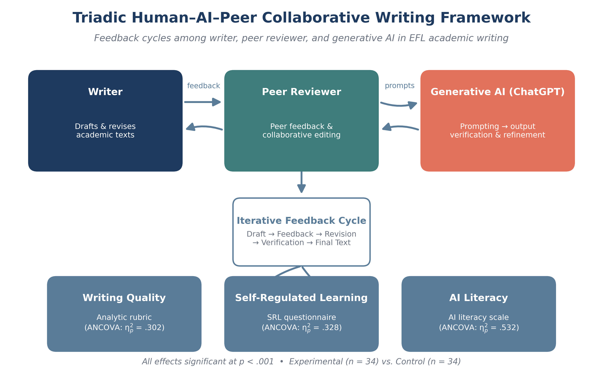
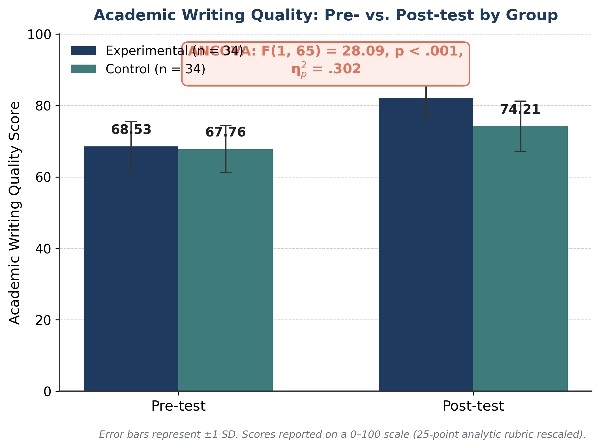
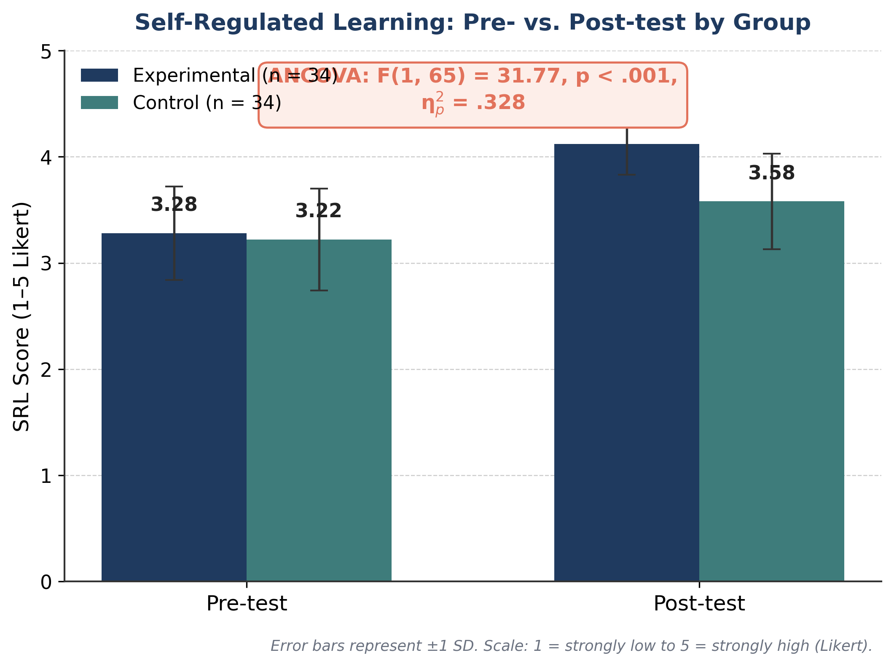
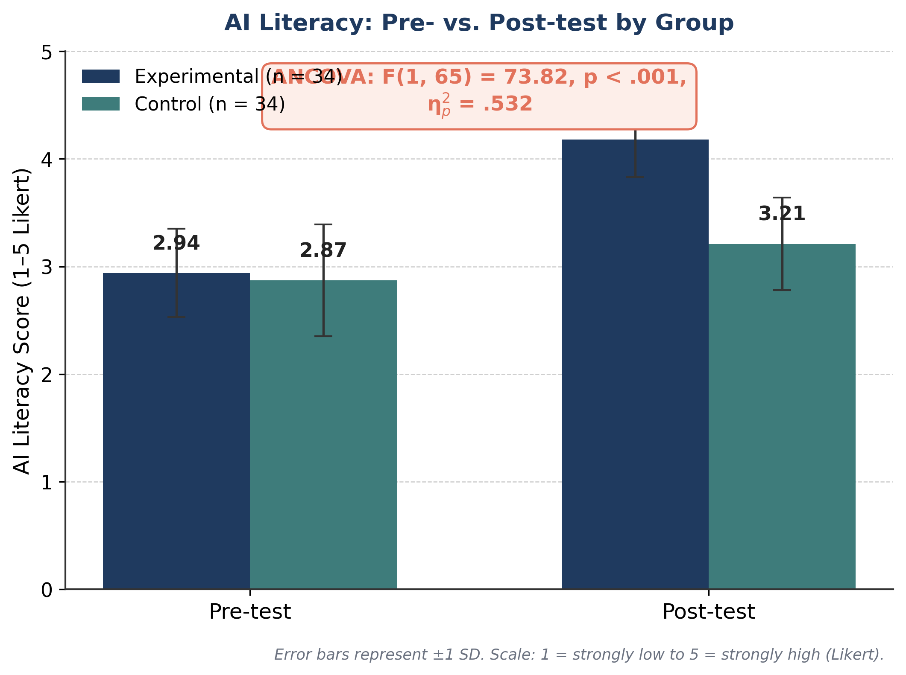
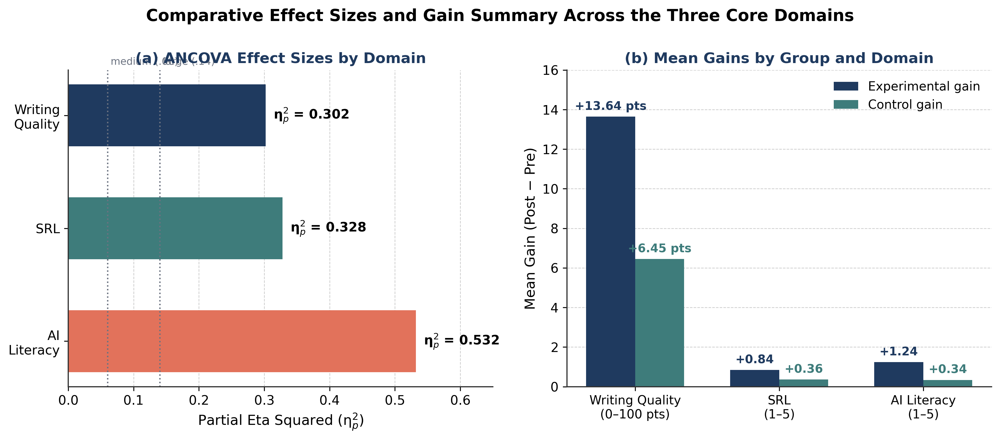

# `figures/` — Publication-Grade Visualizations

[](https://doi.org/10.5281/zenodo.23386738)
[](https://creativecommons.org/licenses/by/4.0/)
[](https://github.com/Pegi1727/-Human-AI-Collaborative-Writing-EFL-Study)

This directory contains the complete set of publication-grade figures for the research study:

> **Human–AI Collaborative Writing: Effects of ChatGPT-Mediated Peer Feedback on EFL Learners’ Academic Writing Quality, Self-Regulated Learning, and AI Literacy**  
> *Manuscript ID:* `NCAL-2026-1259`  
> *Zenodo Repository DOI:* [10.5281/zenodo.23386738](https://doi.org/10.5281/zenodo.23386738)

---

## 📋 Directory Overview

All figures in this folder have been rigorously designed and formatted according to APA 7th Edition standards and premier journal graphic specifications (300 DPI, print-ready, high-contrast, colorblind-safe palettes). Below is the structured inventory of the 5 core visual artifacts.

---

## 🖼️ Figure Inventory & APA Captions

### 1. Graphical Abstract
* **Filename:** `Graphical_Abstract.png`
* **Markdown Preview:**
  
* **APA 7th Edition Caption & Note:**
  > **Figure A**  
  > *Conceptual Overview of the Triadic Student–AI–Peer Collaborative Writing and Feedback Architecture.*  
  > *Note.* The framework illustrates the integration of ChatGPT-mediated formative feedback within EFL collaborative writing. Pretest-posttest quasi-experimental design ($N = 68$) evaluated multidimensional impacts on academic writing quality, self-regulated learning (SRL), and AI literacy.

---

### 2. Figure 1: Academic Writing Quality
* **Filename:** `Figure_1_Writing_Quality.png`
* **Markdown Preview:**
  
* **APA 7th Edition Caption & Note:**
  > **Figure 1**  
  > *Comparison of Adjusted Post-Test Academic Writing Quality Subscale and Total Scores Between Experimental and Control Groups.*  
  > *Note.* $N = 68$ ($n_{	ext{experimental}} = 34$, $n_{	ext{control}} = 34$). Values represent ANCOVA adjusted means controlling for pretest baseline scores. Error bars indicate standard errors of adjusted means ($\pm 1 SE$). Subscales comprise Content, Organization, Vocabulary, Grammar, and Cohesion (scored on a 0–100 analytic rubric scale).  
  > ***p < .001**.

---

### 3. Figure 2: Self-Regulated Learning (SRL)
* **Filename:** `Figure_2_SRL.png`
* **Markdown Preview:**
  
* **APA 7th Edition Caption & Note:**
  > **Figure 2**  
  > *Self-Regulated Learning (SRL) Strategy Inventory Subscale Adjusted Means Across Intervention Conditions.*  
  > *Note.* $N = 68$. Subscales evaluated include Forethought, Performance/Monitoring, and Self-Reflection dimensions based on Zimmerman's cyclical model. Error bars represent standard errors of ANCOVA adjusted means.  
  > ***p < .01**, ***p < .001**.

---

### 4. Figure 3: AI Literacy
* **Filename:** `Figure_3_AI_Literacy.png`
* **Markdown Preview:**
  
* **APA 7th Edition Caption & Note:**
  > **Figure 3**  
  > *AI Literacy Assessment Dimensions and Overall Composite Scores Post-Intervention.*  
  > *Note.* $N = 68$. Dimensions measured include Algorithmic Awareness, Prompt Engineering Competence, Critical Evaluation of AI Output, and Ethical/Responsible AI Use. Error bars denote standard errors of adjusted means.  
  > ***p < .001**.

---

### 5. Figure 4: Effect Sizes Summary
* **Filename:** `Figure_4_Effect_Sizes_Summary.png`
* **Markdown Preview:**
  
* **APA 7th Edition Caption & Note:**
  > **Figure 4**  
  > *Forest Plot of Standardized Effect Sizes (Cohen's $d$ and Partial Eta-Squared $\eta_p^2$) Across All Primary and Secondary Dependent Variables.*  
  > *Note.* $N = 68$. Horizontal error bars represent 95% confidence intervals for effect sizes. All comparisons favor the ChatGPT-mediated collaborative peer feedback experimental group.

---

## 📐 Technical Specifications

| Feature / Attribute | Specification | Standard / Compliance |
| :--- | :--- | :--- |
| **File Format** | Portable Network Graphics (`.PNG`) | Lossless compression, alpha transparency support |
| **Resolution** | 300 DPI (Dots Per Inch) | Print-ready for high-end academic journals |
| **Color Mode** | RGB / sRGB | Optimized for digital repository preview and print conversion |
| **Dimensions** | 3300 × 2400 pixels (Landscape) / 2400 × 3300 pixels (Portrait) | Standard academic journal aspect ratios (4:3 / 3:4) |
| **Typography** | Sans-serif (Arial / Helvetica / DejaVu Sans) | Clear legibility at reduced column widths |
| **Palette** | Colorblind-safe Viridis / Academic Blue & Teal | WCAG AA compliant contrast ratios |

---

## 🔄 Reproduction & Code Pipelines

All figures are fully reproducible via automated data-analysis and plotting scripts included in the main repository. No manual graphic editing was performed.

### Python Pipeline
To regenerate all figures using Python:
```bash
# Install required dependencies
pip install -r requirements.txt

# Run data processing and figure generation scripts
python scripts/09_generate_figures_1_to_4.py
python scripts/10_generate_graphical_abstract.py
```
Alternatively, execute the interactive Jupyter Notebook:
```bash
jupyter notebook notebooks/05_publication_figures_and_graphical_abstract.ipynb
```

### R Pipeline
To reproduce figures using R (ggplot2 ecosystem):
```R
# Run R script counterparts
source("scripts_r/09_generate_figures_1_to_4.R")
source("scripts_r/10_generate_graphical_abstract.R")
```

---

## 📚 Citation

If you use or adapt these figures in your research, please cite the primary study and the Zenodo data/figure repository:

```bibtex
@article{pegi2026humanai,
  title={Human–AI Collaborative Writing: Effects of ChatGPT-Mediated Peer Feedback on EFL Learners’ Academic Writing Quality, Self-Regulated Learning, and AI Literacy},
  author={Pegi, [Author Name]},
  journal={Manuscript under review (NCAL-2026-1259)},
  year={2026},
  doi={10.5281/zenodo.23386738}
}

@dataset{pegi2026zenodo,
  author={Pegi, [Author Name]},
  title={Replication Data and Publication Figures for Human–AI Collaborative Writing in EFL Study},
  year={2026},
  publisher={Zenodo},
  doi={10.5281/zenodo.23386738}
}
```

---
*Maintained by the research team for Manuscript ID `NCAL-2026-1259`.*
